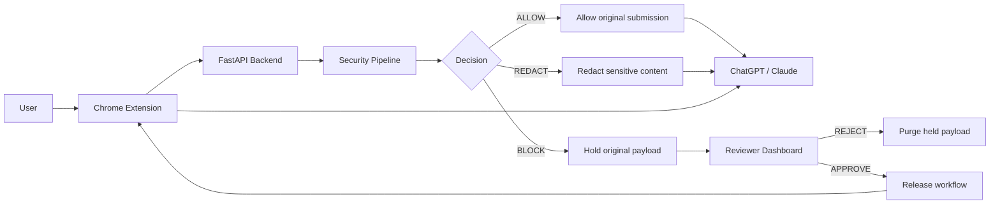
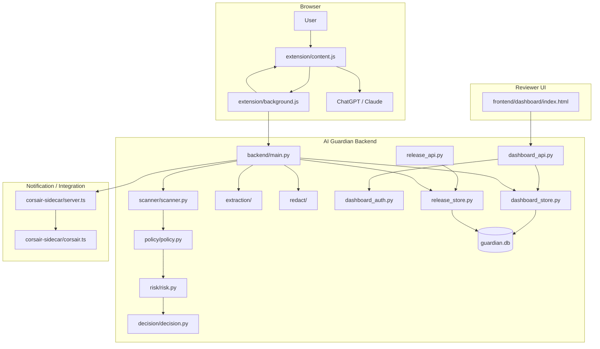
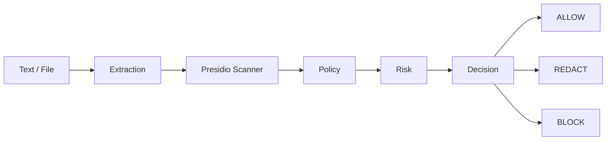
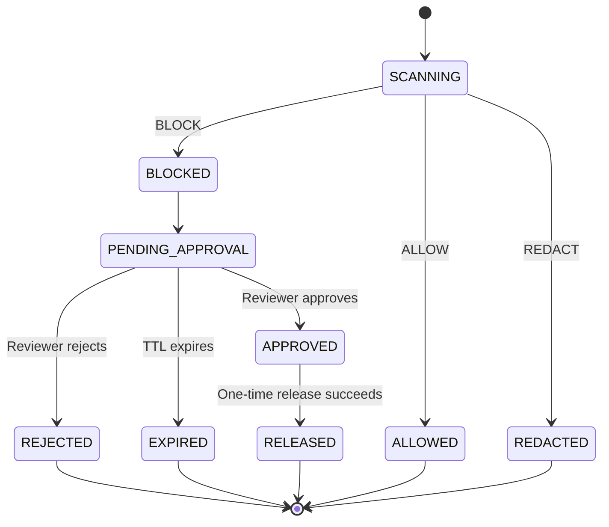
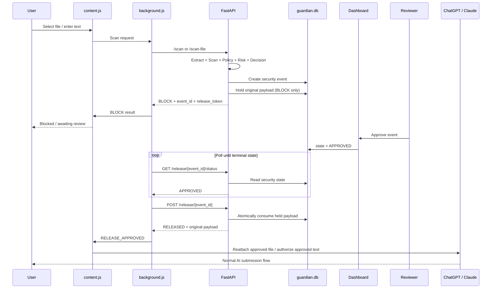
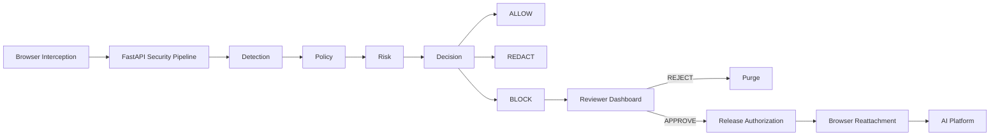

# AI Guardian

AI Guardian is a browser-integrated **Data Loss Prevention (DLP)** system for AI platforms such as ChatGPT and Claude.

It intercepts text and file submissions before they reach the AI platform, analyzes them through a local FastAPI security pipeline, applies policy and risk rules, and then decides whether to **ALLOW**, **REDACT**, or **BLOCK** the submission.

For blocked content, AI Guardian supports a reviewer-gated release workflow: the original payload is held locally, a reviewer approves or rejects the security event from the dashboard, and only an approved release can return the original payload to the browser.

---

## 1. What AI Guardian Does

### Core security flow



The system therefore has two distinct paths:

```text
NORMAL PATH
User → Extension → Scan → Decision → AI Platform

REVIEW PATH
User → Extension → Scan → BLOCK → Hold → Reviewer → APPROVE → Release → Extension → AI Platform
```

---

# 2. Architecture

## High-level architecture



---

# 3. Main Components

## Chrome Extension

Located in:

```text
extension/
├── manifest.json
├── background.js
└── content.js
```

### `content.js`

The content script operates inside supported AI-platform pages.

Responsibilities include:

- detecting supported pages
- intercepting text input
- intercepting file inputs
- intercepting drag-and-drop file uploads
- sending content for security scanning
- displaying Guardian banners/status
- holding blocked content in memory
- receiving reviewer approval messages
- reattaching approved files to the verified file input
- coordinating safe release of blocked text/files

### `background.js`

The Manifest V3 service worker provides the durable extension-side part of the release workflow.

Responsibilities include:

- communication with the FastAPI backend
- maintaining pending release information
- storing session-level release state
- polling release status
- receiving reviewer-approved / terminal states
- sending release results back to the correct browser tab

### `manifest.json`

Defines the extension as a Manifest V3 extension and grants the permissions required by the release workflow.

---

# 4. Backend Security Pipeline

The backend lives under:

```text
backend/
```

The main entry point is:

```text
backend/main.py
```

## Security pipeline



### Scanner

`backend/scanner/scanner.py`

The scanner uses Microsoft Presidio for entity detection.

The configured scanner currently works with entity types including:

- `EMAIL_ADDRESS`
- `PHONE_NUMBER`
- `CREDIT_CARD`
- `US_SSN`
- `PERSON`

### Policy

`backend/policy/policy.py`

`backend/policy/policy.json`

The policy layer determines which detected entities are treated as sensitive.

### Risk

`backend/risk/risk.py`

The risk layer maps detected sensitive entities into risk levels.

The current implementation includes levels such as:

```text
LOW
MEDIUM
HIGH
CRITICAL
```

### Decision

`backend/decision/decision.py`

The decision layer converts risk/policy results into the enforcement action:

```text
ALLOW
REDACT
BLOCK
```

---

# 5. File Processing

AI Guardian has dedicated extraction and redaction modules.

```text
backend/
├── extraction/
│   ├── extraction.py
│   └── image_ocr.py
│
└── redact/
    ├── redact.py
    ├── pdf_redact.py
    ├── docx_redact.py
    ├── image_redact.py
    └── image_mapping.py
```

## Supported processing paths

### PDF

PDF content can be extracted, analyzed, and redacted through the PDF-specific processing path.

### DOCX

DOCX content can be extracted and redacted through the DOCX-specific processing path.

### Images

Image content can be processed using the image pipeline.

### OCR

`backend/extraction/image_ocr.py`

The OCR layer uses Tesseract to extract text from image content so that extracted text can participate in the security analysis.

---

# 6. BLOCK + Reviewer Approval Architecture

The reviewer-gated release flow is a separate state machine from the basic scan.

## State machine



## Detailed release sequence



---

# 7. Secure Held-Payload Design

Blocked payloads are kept separately from dashboard metadata.

The release store is:

```text
backend/release_store.py
```

The held payload record conceptually contains:

```text
event_id
release_token_hash
payload_type
raw_text OR raw_file_base64
original_filename
mime_type
created_at
expires_at
consumed
```

### Important properties

- The plaintext release token is not stored in the release table.
- The release token is hashed.
- The held payload has a short TTL.
- Rejected payloads are cleared.
- Expired payloads are cleared.
- Released payloads are consumed once.
- The release operation is atomic.
- The same release cannot be consumed repeatedly.

---

# 8. Database Model

The primary local database is SQLite:

```text
backend/guardian.db
```

It is intentionally **not committed to GitHub**.

## Security events

The dashboard store defines `security_events` with an identifier field:

```text
id
timestamp
username
site
input_type
filename
risk
decision
state
status_detail
entities_json
corsair_token
reviewed_by
reviewed_at
created_at
```

## Audit events

Audit records reference the security event:

```text
id
event_id
actor
action
timestamp
detail
```

## Held payloads

Reviewer-gated release records are stored in:

```text
held_payloads
```

and connect to the corresponding security event through `event_id`.

---

# 9. Reviewer Dashboard

The reviewer interface is intentionally simple and static.

Location:

```text
frontend/dashboard/index.html
```

It is served directly by Python's built-in HTTP server.

The dashboard is responsible for:

- reviewing security events
- inspecting metadata
- authenticating the reviewer
- approving blocked events
- rejecting blocked events
- displaying audit information

The dashboard does not require React/Vite/npm.

---

# 10. Dashboard Authentication

The backend provides reviewer authentication through:

```text
backend/dashboard_auth.py
```

The dashboard API is implemented in:

```text
backend/dashboard_api.py
```

The authentication layer uses hashed reviewer credentials and server-side sessions.

---

# 11. Corsair Sidecar

The Corsair integration lives in:

```text
corsair-sidecar/
├── corsair.ts
├── server.ts
├── migration.sql
├── package.json
├── pnpm-lock.yaml
├── pnpm-workspace.yaml
└── test_corsair.ts
```

The sidecar is used as a notification/integration component.

The intended security boundary is:

```text
Security metadata → Corsair

Raw sensitive payload → NEVER sent to Corsair
```

---

# 12. Repository Structure

```text
ai-guardian/
│
├── .gitignore
├── README.md
│
├── backend/
│   ├── main.py
│   ├── dashboard_api.py
│   ├── dashboard_auth.py
│   ├── dashboard_store.py
│   ├── release_api.py
│   ├── release_store.py
│   │
│   ├── scanner/
│   ├── policy/
│   ├── risk/
│   ├── decision/
│   ├── extraction/
│   ├── redact/
│   │
│   └── test_*.py
│
├── extension/
│   ├── manifest.json
│   ├── background.js
│   └── content.js
│
├── frontend/
│   └── dashboard/
│       └── index.html
│
└── corsair-sidecar/
    ├── corsair.ts
    ├── server.ts
    ├── migration.sql
    ├── package.json
    ├── pnpm-lock.yaml
    ├── pnpm-workspace.yaml
    └── test_corsair.ts
```

---

# 13. Local Setup

## Prerequisites

Install:

- Python 3.x
- Google Chrome / Chromium
- Git

Additional dependencies are required by the Python and Node/TypeScript components.

---

# 14. Start the Backend

Open a terminal in:

```text
backend/
```

Run:

```powershell
uvicorn main:app --reload
```

The API is expected at:

```text
http://127.0.0.1:8000
```

---

# 15. Start the Dashboard

Open another terminal in:

```text
frontend/dashboard/
```

Run:

```powershell
python -m http.server 5173
```

Open:

```text
http://localhost:5173
```

---

# 16. Load the Chrome Extension

Open:

```text
chrome://extensions
```

Enable:

```text
Developer mode
```

Choose:

```text
Load unpacked
```

Select the repository's:

```text
extension/
```

folder.

---

# 17. Basic Test Workflow

## Text

```text
1. Open ChatGPT or Claude.
2. Enter text containing synthetic sensitive data.
3. Submit it.
4. Confirm AI Guardian intercepts the request.
5. Observe the security decision.
```

## File

```text
1. Open ChatGPT or Claude.
2. Select a test file.
3. AI Guardian intercepts the file.
4. The backend scans the file.
5. Observe ALLOW / REDACT / BLOCK.
```

## Reviewer-gated BLOCK

```text
1. Upload a file containing synthetic PII.
2. Confirm Guardian returns BLOCK.
3. Confirm the event appears in the dashboard.
4. Approve the event from the dashboard.
5. Wait for the extension to observe APPROVED.
6. Confirm the release succeeds.
7. Confirm the original file is reattached.
```

---

# 18. Verified Release Demonstrations

The reviewer-gated release path has been manually verified with:

```text
PDF
BLOCK
→ dashboard APPROVE
→ release
→ browser reattachment
→ successful AI-platform receipt
```

and:

```text
DOCX
BLOCK
→ dashboard APPROVE
→ release
→ browser reattachment
→ successful AI-platform receipt
```

These tests demonstrated the complete backend-to-browser release path.

---

# 19. Test Code

Backend test files are located under:

```text
backend/
```

Examples include:

```text
test_dashboard_actions.py
test_dashboard_api.py
test_dashboard_auth.py
test_dashboard_store.py
test_docx_extraction.py
test_docx_redact_backend.py
test_docx_redact_document.py
test_docx_redact_mapping.py
test_docx_redact_paragraph.py
test_docx_redact_verification.py
test_extraction.py
test_image_backend.py
test_image_mapping.py
test_image_ocr.py
test_image_redact.py
test_ocr_spike.py
```

Run:

```powershell
pytest
```

Some tests require optional system dependencies such as OCR tooling or the project's installed Python packages.

---

# 20. Git / Secrets Policy

The repository deliberately ignores local runtime state and sensitive configuration.

Ignored examples include:

```text
.env
*.db
node_modules/
__pycache__/
*.backup*
generated test artifacts
```

Do **not** commit:

- API keys
- passwords
- tokens
- local SQLite databases
- private service credentials
- browser-specific runtime files

Use an `.env.example` pattern for documenting required environment variables without exposing secrets.

---

# 21. Security Principles

### Fail closed

A security failure should not silently turn a BLOCK decision into an ALLOW decision.

### Least exposure

Raw sensitive payloads should not be sent to dashboard metadata, Slack/Corsair notification payloads, or audit logs unnecessarily.

### Explicit approval

A blocked payload requires an explicit reviewer decision before release.

### Exact release

The release workflow is tied to the specific held event and its release authorization.

### One-time consumption

Successful release consumes the held payload so the same authorization is not reusable.

### Short-lived storage

Raw blocked payloads are retained only for the reviewer-gated release period.

---

# 22. Limitations

AI Guardian is currently a local / hackathon-oriented DLP prototype.

This repository does **not** establish:

- enterprise-scale deployment readiness
- complete PII coverage
- complete browser security against every possible bypass
- universal compatibility with every AI website
- distributed/high-availability backend operation
- production hardening for multi-tenant deployment
- perfect detection of every sensitive-data pattern

The detection coverage depends on the configured Presidio entities, policy configuration, and extraction capabilities implemented in this repository.

---

# 23. Troubleshooting

## Backend does not start

Confirm you are inside:

```text
backend/
```

and run:

```powershell
uvicorn main:app --reload
```

## Dashboard does not open

Confirm you are inside:

```text
frontend/dashboard/
```

and run:

```powershell
python -m http.server 5173
```

## Extension is not active

Confirm:

- Developer mode is enabled.
- `extension/` was loaded as the unpacked extension.
- ChatGPT or Claude matches the manifest URL patterns.
- The backend is running on `127.0.0.1:8000`.

## File release fails

Inspect both:

- the browser page console for `content.js`
- the extension service-worker console for `background.js`

The release path is:

```text
Dashboard APPROVE
→ backend release status
→ backend release
→ RELEASE_APPROVED
→ content.js
→ file reattachment
```

The first failing stage is the stage that should be debugged.

---

# 24. Project Status

Current implemented architecture:



The reviewer-gated file-release workflow has been manually verified for both PDF and DOCX test cases.

---

# 25. License

Choose and add an appropriate open-source license before public redistribution.

---

## AI Guardian

**Inspect before you send.  
Block when necessary.  
Release only with approval.**
