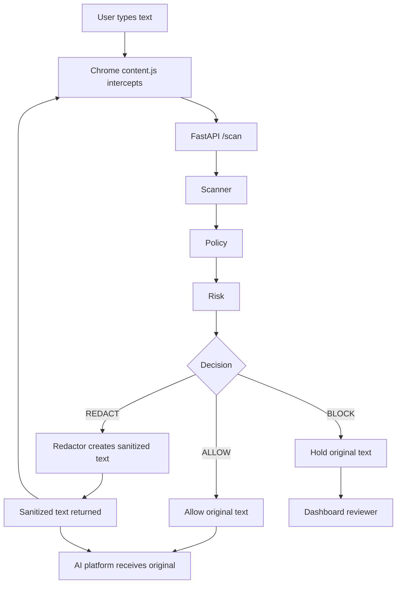
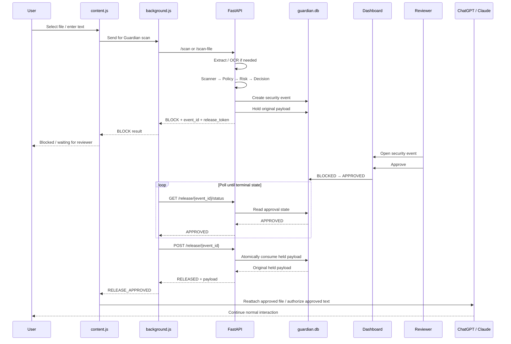
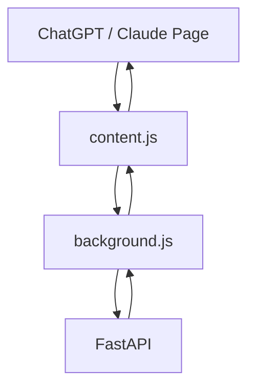
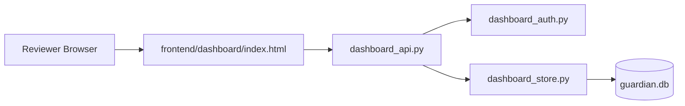
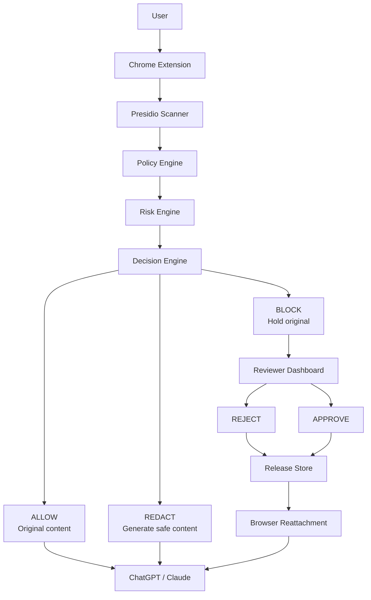

# AI Guardian

**AI Guardian is a browser-integrated Data Loss Prevention (DLP) system for AI platforms such as ChatGPT and Claude.**

Its job is simple:

> **Inspect what the user is about to send to an AI system, decide whether it is safe, and enforce the decision before the content reaches the AI platform.**

The system supports three security decisions:

```text
                    ┌───────────────┐
                    │  User submits │
                    │ text / file   │
                    └───────┬───────┘
                            │
                            ▼
                    ┌───────────────┐
                    │ Scan + Policy │
                    │ + Risk        │
                    └───────┬───────┘
                            │
                    ┌───────┼────────┐
                    │       │        │
                    ▼       ▼        ▼
                 ALLOW   REDACT    BLOCK
                    │       │        │
                    ▼       ▼        ▼
                 Send     Create   Hold + Review
                 original safe      │
                         content     ▼
                                  APPROVE/REJECT
```

The most important distinction is:

```text
ALLOW  → original content is allowed to continue
REDACT → original content is NOT sent; a sanitized replacement is produced
BLOCK  → original content is NOT sent; it is held for reviewer approval
```

---

# 1. What AI Guardian Protects

AI Guardian sits between the user and the AI platform.

Without Guardian:

```text
User
  │
  ▼
ChatGPT / Claude
```

With Guardian:

```text
User
  │
  ▼
AI Guardian Chrome Extension
  │
  ▼
FastAPI Security Pipeline
  │
  ├── Scanner
  ├── Policy
  ├── Risk
  └── Decision
  │
  ├───────────────┬────────────────┐
  ▼               ▼                ▼
ALLOW           REDACT           BLOCK
  │               │                │
  ▼               ▼                ▼
Original        Sanitized        Reviewer
content         content          approval
  │               │                │
  └───────────────┴────────────────┴──► ChatGPT / Claude
```

The browser extension performs the interception, while the backend performs the security decision.

---

# 2. The Three Decisions — Explained for a Complete Beginner

## ALLOW

**Meaning:**

> "We checked this content and decided it is safe enough to continue."

Example:

```text
User:
"Explain binary search in C++."
```

The scanner finds no sensitive information.

The decision becomes:

```text
ALLOW
```

Flow:

```text
User text
   │
   ▼
Guardian scans it
   │
   ▼
No blocking/redaction condition
   │
   ▼
ALLOW
   │
   ▼
Original text continues to the AI platform
```

The important point is:

**ALLOW does not generate a new version of the message.**

The original input is considered safe and is allowed to continue.

---

# 3. REDACT

## What does REDACT mean?

Redact means:

> **Do not send the original sensitive content. Replace the sensitive parts with safe placeholders or generate a sanitized file, then send/use the sanitized result instead.**

Example:

```text
Original:

"My email is john@example.com and my phone is 555-123-4567."
```

The scanner may detect:

```text
EMAIL_ADDRESS
PHONE_NUMBER
```

The text redactor produces something like:

```text
"My email is [REDACTED_EMAIL_ADDRESS] and my phone is [REDACTED_PHONE_NUMBER]."
```

So the AI platform receives the **new redacted text**, not the original sensitive text.

The text redactor works by taking the detected entity positions and replacing them from right-to-left so earlier replacements do not change the positions of later replacements. The repository's `Redactor` class performs this replacement and uses placeholders of the form `[REDACTED_<ENTITY_TYPE>]`.

---

# 4. REDACT — Text Flow

The text path is:



Conceptually:

```text
Original text
      │
      ▼
Detect sensitive spans
      │
      ▼
Example:
john@example.com
      │
      ▼
Replace sensitive span
      │
      ▼
[REDACTED_EMAIL_ADDRESS]
      │
      ▼
Return sanitized message
      │
      ▼
Send sanitized message
```

The backend's common security pipeline calculates:

```text
entities
risk
decision
```

and only when the decision is `REDACT` does it call the text redactor. The returned result contains `redacted_text`.

---

# 5. REDACT — What Happens to Files?

For files, REDACT is more than replacing text in a Python string.

The system has format-specific redaction modules:

```text
backend/redact/
├── redact.py
├── pdf_redact.py
├── docx_redact.py
├── image_redact.py
└── image_mapping.py
```

The design is:

```text
File
 │
 ▼
Extract text / OCR
 │
 ▼
Scan + Policy + Risk
 │
 ▼
REDACT
 │
 ├── PDF   → PDF redaction
 ├── DOCX  → DOCX redaction
 └── Image → OCR mapping + image redaction
 │
 ▼
Generate new safe file
 │
 ▼
Verify the generated file
 │
 ▼
Return redacted file
```

The **original file is not the file sent as the redacted result**.

A new sanitized output is produced.

---

# 6. PDF REDACTION

The PDF redaction implementation is format-specific.

Conceptually:

```text
Original PDF
    │
    ▼
Extract pages / sensitive values
    │
    ▼
Find sensitive text regions
    │
    ▼
Apply PDF redactions
    │
    ▼
Scrub / rewrite the PDF
    │
    ▼
Generate fresh PDF bytes
    │
    ▼
Re-extract generated PDF
    │
    ▼
Verify original sensitive values are gone
    │
    ├── PASS → return safe PDF
    │
    └── FAIL → fail closed / BLOCK
```

The implementation uses a full rewrite rather than relying on an incremental PDF save, and it performs post-redaction verification using the project's extraction path.

The security philosophy is:

```text
Could not prove the generated PDF is safe?
                │
                ▼
             BLOCK
```

It does **not** silently return a questionable "best effort" redacted document.

---

# 7. DOCX REDACTION

The DOCX path follows the same high-level security contract:

```text
Original DOCX
    │
    ▼
Extract document text
    │
    ▼
Detect sensitive entities
    │
    ▼
REDACT
    │
    ▼
Modify document package
    │
    ▼
Generate fresh DOCX
    │
    ▼
Verify the output
    │
    ├── PASS → return safe DOCX
    │
    └── FAIL → fail closed
```

The repository contains dedicated DOCX extraction and redaction tests.

The output is a **new DOCX**, not the original blocked document.

---

# 8. IMAGE REDACTION + OCR

Images are different because the sensitive information may exist as pixels rather than normal text.

The image path uses OCR:

```text
Image
 │
 ▼
OCR
 │
 ▼
Extracted words + regions
 │
 ▼
Security pipeline
 │
 ▼
REDACT
 │
 ▼
Map sensitive OCR regions to image coordinates
 │
 ▼
Paint opaque redaction regions
 │
 ▼
Serialize a new image
 │
 ▼
OCR the generated image again
 │
 ▼
Verify sensitive values are no longer detectable
```

The image redaction module performs opaque pixel redaction on mapped OCR regions and has a separate verification stage.

---

# 9. BLOCK

BLOCK is fundamentally different from REDACT.

With REDACT:

```text
Original
   ↓
Sanitized replacement
   ↓
Continue
```

With BLOCK:

```text
Original
   ↓
STOP
```

The original sensitive payload is **not sent to the AI platform**.

Instead, AI Guardian creates a security event and, for the reviewer-gated release path, stores the original blocked payload in the held-payload store.

---

# 10. BLOCK — Full Reviewer Flow

The complete BLOCK lifecycle is:



---

# 11. BLOCK — What Is Stored?

For a blocked payload, the backend creates a security event.

The release store also keeps a held-payload record containing conceptually:

```text
event_id
release_token_hash
payload_type
raw_text OR raw_file_base64
original_filename
mime_type
created_at
expires_at
consumed
```

The release token itself is not stored in plaintext.

Instead:

```text
release token
      │
      ▼
hash
      │
      ▼
store hash
```

Later:

```text
token supplied by extension
      │
      ▼
hash supplied token
      │
      ▼
compare with stored hash
```

---

# 12. Why Is the Payload Held?

The whole point of reviewer approval is to avoid this unsafe pattern:

```text
Sensitive file
   ↓
BLOCK
   ↓
"Reviewer approved it"
   ↓
User must manually select it again
```

The project instead supports:

```text
Sensitive file
   ↓
BLOCK
   ↓
Hold exact original file
   ↓
Reviewer approves exact event
   ↓
Release exact held file
   ↓
Reattach it to the browser
```

This is why the extension needs to preserve the relationship between:

```text
event_id
+
held payload
+
browser target
```

The release should not accidentally apply approval from one event to a different file.

---

# 13. BLOCK — APPROVE

After the dashboard reviewer clicks **APPROVE**:

```text
Dashboard
   │
   ▼
Security event:
BLOCKED → APPROVED
   │
   ▼
Extension polls
   │
   ▼
Backend reports:
APPROVED
   │
   ▼
Extension requests one-time release
   │
   ▼
Backend atomically consumes held payload
   │
   ▼
Backend returns RELEASED + original payload
   │
   ▼
Extension receives RELEASE_APPROVED
   │
   ▼
Browser reattaches exact file
```

For a file-input upload, the extension verifies the previously assigned input marker and then uses `DataTransfer` to put the held file back into the verified input.

This is the path that was manually verified during development for both PDF and DOCX test files.

---

# 14. BLOCK — REJECT

Reject is much simpler:

```text
BLOCK
  │
  ▼
Reviewer presses REJECT
  │
  ▼
Security event → REJECTED
  │
  ▼
Held payload is cleared
  │
  ▼
Extension receives terminal state
  │
  ▼
Original payload is not released
```

The payload should not remain available after a reviewer explicitly rejects it.

---

# 15. BLOCK — EXPIRY

Held payloads are short-lived.

Conceptually:

```text
BLOCK
  │
  ▼
PENDING_APPROVAL
  │
  ├── APPROVED → RELEASED
  ├── REJECTED → payload cleared
  └── TTL reached → EXPIRED + payload cleared
```

The purpose of the TTL is to avoid keeping raw sensitive content indefinitely.

The current release store uses a 20-minute release TTL.

---

# 16. ALLOW vs REDACT vs BLOCK

| Decision | Original sent? | Replacement generated? | Reviewer required? |
|---|---:|---:|---:|
| ALLOW | Yes | No | No |
| REDACT | No | Yes | No |
| BLOCK | No | No | Yes, for reviewer release |

The easiest way to remember it:

```text
ALLOW
"I trust this input."

REDACT
"I want the task, but I must remove the sensitive parts first."

BLOCK
"I cannot safely send this as-is. Stop it and require explicit approval."
```

---

# 17. The Backend Pipeline

The main security pipeline is:

```text
Input
  │
  ▼
Scanner
  │
  ▼
Policy
  │
  ▼
Risk
  │
  ▼
Decision
  │
  ├── ALLOW
  ├── REDACT
  └── BLOCK
```

The backend implementation calls these components in order:

```text
Scanner
→ PolicyEngine
→ RiskEngine
→ DecisionEngine
```

When the decision is `REDACT`, it generates `redacted_text` using the text `Redactor`.

The common pipeline is shared by `/scan` and file processing after text extraction/OCR.

---

# 18. Detection

The scanner uses Microsoft Presidio.

The current configured entity categories include:

```text
EMAIL_ADDRESS
PHONE_NUMBER
CREDIT_CARD
US_SSN
PERSON
```

Detection produces entity information including locations/spans used by the redaction layer.

---

# 19. Policy

Policy answers:

> "Which detected entities do we actually treat as sensitive?"

The policy configuration is in:

```text
backend/policy/
├── policy.py
└── policy.json
```

The pipeline therefore does not simply say:

```text
"Presidio found something → automatically block."
```

Instead:

```text
Detection
   ↓
Policy evaluation
   ↓
Only policy-relevant findings
   ↓
Risk calculation
```

---

# 20. Risk

The risk engine converts the policy findings into a security risk level.

Current levels include:

```text
LOW
MEDIUM
HIGH
CRITICAL
```

The risk becomes the input to the decision engine.

---

# 21. Decision

The decision engine produces one of:

```text
ALLOW
REDACT
BLOCK
```

The exact mapping is defined by:

```text
backend/decision/decision.py
```

The important architectural point is:

```text
Scanner does not decide the final action.
Policy does not decide the final action.
Risk does not decide the final action.

DecisionEngine makes the final security decision.
```

---

# 22. Text Example — All Three Decisions

Suppose the user submits:

```text
Please email john@example.com about this project.
```

## Case A — ALLOW

If the resulting risk/decision allows it:

```text
Original text
    ↓
ALLOW
    ↓
Original text continues
```

The AI platform receives:

```text
Please email john@example.com about this project.
```

---

## Case B — REDACT

If the decision is REDACT:

```text
Original text
    ↓
Detect john@example.com
    ↓
Redactor
    ↓
Please email [REDACTED_EMAIL_ADDRESS] about this project.
    ↓
Send sanitized text
```

The original sensitive email is not what continues to the AI platform.

---

## Case C — BLOCK

If the decision is BLOCK:

```text
Original text
    ↓
BLOCK
    ↓
Do not send original text
    ↓
Create security event
    ↓
Hold original text
    ↓
Reviewer approval required
```

Only an approved release can continue the blocked workflow.

---

# 23. File Example — All Three Decisions

Suppose a user uploads a PDF containing sensitive information.

## ALLOW

```text
PDF
 ↓
Extract
 ↓
Scan
 ↓
ALLOW
 ↓
Original PDF continues
```

## REDACT

```text
PDF
 ↓
Extract
 ↓
Scan
 ↓
REDACT
 ↓
Generate sanitized PDF
 ↓
Verify sanitized PDF
 ↓
Return safe PDF
```

## BLOCK

```text
PDF
 ↓
Extract
 ↓
Scan
 ↓
BLOCK
 ↓
Hold original PDF
 ↓
Reviewer
 ├── REJECT → destroy held payload
 └── APPROVE → release exact original PDF
```

---

# 24. Browser Extension Architecture



For normal scanning:

```text
Page
 ↓
content.js
 ↓
background.js
 ↓
FastAPI
 ↓
decision
 ↓
background.js
 ↓
content.js
 ↓
Page
```

For reviewer release:

```text
BLOCK
 ↓
background.js records pending release
 ↓
Dashboard reviewer acts
 ↓
background.js polls
 ↓
RELEASE_APPROVED
 ↓
content.js safely handles the exact pending payload
```

---

# 25. Dashboard Architecture



The dashboard is intentionally a static HTML application.

It does not require a frontend framework or Vite development server.

---

# 26. Database Architecture

The main SQLite database contains dashboard/security metadata.

Conceptually:

```text
security_events
      │
      │ 1-to-many
      ▼
audit_events

security_events
      │
      │ 1-to-0/1 for blocked payload
      ▼
held_payloads
```

Important distinction:

```text
Dashboard data
    ↓
metadata

Held payload store
    ↓
raw blocked content
```

The raw held content is kept separate from dashboard metadata.

---

# 27. Why `guardian.db` Is Not Committed

The SQLite database is runtime state.

It contains things such as:

```text
security events
audit events
review states
local runtime information
```

It should not be treated as source code.

GitHub should contain:

```text
Python code
JavaScript code
TypeScript code
HTML
JSON
SQL schema/migrations
tests
README
```

not your local runtime history.

---

# 28. Why `.env` Is Not Committed

Environment files can contain:

```text
passwords
API keys
tokens
secrets
machine-specific configuration
```

The repository therefore ignores `.env`.

Never replace this rule with:

```text
"the current .env is safe, so I can upload it"
```

Keep secrets outside Git.

---

# 29. Corsair Sidecar

The project also contains:

```text
corsair-sidecar/
```

with TypeScript-based integration code.

Its role is notification/integration rather than the primary security decision.

The security rule is:

```text
Security metadata
        ↓
Corsair

Raw sensitive payload
        ↓
NOT sent to Corsair
```

---

# 30. Current Project Structure

```text
ai-guardian/
│
├── .gitignore
├── README.md
│
├── backend/
│   ├── main.py
│   ├── dashboard_api.py
│   ├── dashboard_auth.py
│   ├── dashboard_store.py
│   ├── release_api.py
│   ├── release_store.py
│   │
│   ├── decision/
│   ├── extraction/
│   ├── policy/
│   ├── redact/
│   ├── risk/
│   ├── scanner/
│   │
│   └── test_*.py
│
├── extension/
│   ├── manifest.json
│   ├── background.js
│   └── content.js
│
├── frontend/
│   └── dashboard/
│       └── index.html
│
└── corsair-sidecar/
    ├── corsair.ts
    ├── server.ts
    ├── migration.sql
    ├── package.json
    ├── pnpm-lock.yaml
    ├── pnpm-workspace.yaml
    └── test_corsair.ts
```

---

# 31. How To Run — Backend

Open **Terminal 1**.

Move into the backend folder:

```powershell
cd backend
```

Run:

```powershell
uvicorn main:app --reload
```

The backend should run at:

```text
http://127.0.0.1:8000
```

### What does `--reload` mean?

It means:

```text
You edit Python code
       ↓
Uvicorn notices the file changed
       ↓
Backend reloads automatically
```

It is useful during development.

It is not a requirement for the application itself.

---

# 32. How To Run — Dashboard

Open **Terminal 2**.

Move into:

```text
frontend/dashboard
```

Run:

```powershell
python -m http.server 5173
```

Open:

```text
http://localhost:5173
```

### What does this command mean?

```text
python
   ↓
run Python's built-in HTTP server module
   ↓
listen on port 5173
   ↓
serve files from the current folder
```

So:

```text
frontend/dashboard/index.html
```

becomes available through:

```text
http://localhost:5173/
```

No:

```text
npm run dev
```

is required for this dashboard.

---

# 33. How To Load The Extension

Open:

```text
chrome://extensions
```

Turn on:

```text
Developer mode
```

Click:

```text
Load unpacked
```

Select:

```text
ai-guardian/extension
```

Chrome then loads:

```text
extension/manifest.json
extension/background.js
extension/content.js
```

---

# 34. Full Local Startup

The normal local setup is:

## Terminal 1

```powershell
cd backend
uvicorn main:app --reload
```

## Terminal 2

```powershell
cd frontend/dashboard
python -m http.server 5173
```

## Browser

```text
chrome://extensions
```

Then load:

```text
extension/
```

## Dashboard

```text
http://localhost:5173
```

## Backend

```text
http://127.0.0.1:8000
```

---

# 35. Complete End-to-End Example

Suppose a user uploads a DOCX containing synthetic PII.

```text
USER
 │
 ▼
Chrome file picker
 │
 ▼
content.js intercepts file
 │
 ▼
background.js
 │
 ▼
POST /scan-file
 │
 ▼
FastAPI
 │
 ├── DOCX extraction
 │
 ├── Scanner
 │
 ├── Policy
 │
 ├── Risk
 │
 └── Decision
 │
 ├─────────────┬───────────────────┐
 ▼             ▼                   ▼
ALLOW        REDACT               BLOCK
 │             │                   │
 │             │                   ├── security event
 │             │                   ├── held payload
 │             │                   └── reviewer
 │             │
 │             └── create safe DOCX
 │
 └── continue
```

---

# 36. What Happens After BLOCK

If the decision is BLOCK:

```text
BLOCK
 ↓
Event is created
 ↓
Original payload is held
 ↓
Release token is generated
 ↓
Token hash is stored
 ↓
Dashboard can show the event
 ↓
Reviewer decides
```

The browser does not simply continue sending the blocked data.

---

# 37. What Happens After APPROVE

```text
APPROVE
 ↓
security event becomes APPROVED
 ↓
background.js polls status
 ↓
APPROVED received
 ↓
background.js requests release
 ↓
backend atomically consumes the payload
 ↓
backend returns RELEASED + payload
 ↓
RELEASE_APPROVED reaches content.js
 ↓
content.js verifies the pending browser target
 ↓
file is reattached
```

For the verified file-input path, the extension uses the exact pending input marker rather than blindly selecting an arbitrary file input.

---

# 38. What Happens After REJECT

```text
REJECT
 ↓
security event becomes REJECTED
 ↓
raw held payload is cleared
 ↓
extension receives terminal state
 ↓
nothing is released
```

---

# 39. What Happens When A Release Expires

```text
20-minute release TTL
        ↓
No approval/release
        ↓
EXPIRED
        ↓
Raw held payload cleared
```

The held record can remain as a tombstone for state tracking while the sensitive payload itself is cleared.

---

# 40. Fail-Closed Philosophy

The project intentionally follows this principle:

> **When the system cannot prove that a redacted output is safe, or cannot safely complete a protected operation, it should not silently allow the original sensitive content through.**

Examples:

```text
Redaction verification fails
        ↓
BLOCK / fail closed

Held payload release invalid
        ↓
No release

Unsupported redaction path
        ↓
Do not send original file
```

This is especially important for file redaction.

---

# 41. Security Separation

The project separates these concerns:

```text
Detection
   ↓
"What sensitive information is present?"

Policy
   ↓
"Which findings matter?"

Risk
   ↓
"How severe is the finding?"

Decision
   ↓
"What should we do?"

Enforcement
   ↓
"How do we stop/modify/send it?"

Reviewer
   ↓
"Should this specific blocked request be released?"
```

This separation makes the project easier to understand, test, and debug.

---

# 42. Testing

The backend contains tests covering areas including:

```text
dashboard actions
dashboard API
dashboard authentication
dashboard store
document extraction
DOCX redaction
image processing
image OCR
image redaction
PDF/document extraction
```

Run from the backend environment:

```powershell
pytest
```

Some tests depend on locally installed project/system packages. The repository currently does not include a single universal `requirements.txt`, so the execution environment must have the backend dependencies installed.

---

# 43. Verified Reviewer Release Tests

During development, the reviewer-gated file release flow was manually verified with:

```text
PDF
BLOCK → APPROVE → RELEASE → REATTACH
```

and:

```text
DOCX
BLOCK → APPROVE → RELEASE → REATTACH
```

The important verified sequence was:

```text
BLOCK
→ dashboard event
→ APPROVE
→ backend status becomes APPROVED
→ backend release succeeds
→ RELEASE_APPROVED reaches extension
→ exact file is re-injected
→ AI platform receives the file
```

---

# 44. Debugging Strategy

When something fails, do not randomly edit multiple files.

Debug from the first broken stage:

```text
Browser
  ↓
content.js
  ↓
background.js
  ↓
FastAPI
  ↓
database
  ↓
dashboard
  ↓
release API
  ↓
content.js reattachment
```

For example:

```text
GET /release/.../status = 500
```

means:

```text
First investigate:
release status backend
```

not:

```text
rewrite content.js
```

This stage-by-stage approach is especially important in a multi-component browser/backend system.

---

# 45. Browser Console vs Service Worker Console

There are two different places to debug the extension.

## Page console

Used mainly for:

```text
content.js
```

Open DevTools on the ChatGPT/Claude page.

## Service worker console

Used mainly for:

```text
background.js
```

Open:

```text
chrome://extensions
```

Find AI Guardian and inspect its service worker.

A failure in `background.js` can therefore be invisible in the normal ChatGPT page console.

---

# 46. Privacy

The system is designed to avoid unnecessary propagation of raw sensitive information.

Dashboard data should use metadata.

Corsair/notification paths should use metadata.

Held payloads are stored only for the reviewer-gated release period.

The release token is represented server-side using a hash rather than storing the plaintext token.

---

# 47. Limitations

AI Guardian is a local/hackathon-oriented prototype.

It does not claim:

- complete PII coverage
- perfect detection
- universal compatibility with every AI platform
- protection against every browser-level bypass
- enterprise-scale deployment readiness
- distributed high-availability operation
- a complete production credential-management system
- absolute forensic guarantees for every possible document recovery technique

The PDF redaction verification is specifically scoped to the project's extraction/verification method and is not an absolute claim about every possible forensic recovery technique.

---

# 48. Important Files

## Core backend

```text
backend/main.py
```

FastAPI entry point and main scanning/file workflow.

## Scanner

```text
backend/scanner/scanner.py
```

Presidio-based entity detection.

## Policy

```text
backend/policy/policy.py
backend/policy/policy.json
```

Sensitive-entity policy.

## Risk

```text
backend/risk/risk.py
```

Risk calculation.

## Decision

```text
backend/decision/decision.py
```

ALLOW / REDACT / BLOCK decision.

## Text redaction

```text
backend/redact/redact.py
```

Creates sanitized text using redaction placeholders.

## PDF redaction

```text
backend/redact/pdf_redact.py
```

Format-specific PDF redaction and verification.

## DOCX redaction

```text
backend/redact/docx_redact.py
```

Format-specific DOCX redaction.

## Image redaction

```text
backend/redact/image_redact.py
```

OCR-region based image redaction and verification.

## Reviewer dashboard

```text
backend/dashboard_api.py
backend/dashboard_auth.py
backend/dashboard_store.py
frontend/dashboard/index.html
```

## Reviewer-gated release

```text
backend/release_api.py
backend/release_store.py
extension/background.js
extension/content.js
```

---

# 49. Git Repository Hygiene

The repository intentionally ignores:

```text
.env
*.db
node_modules/
__pycache__/
*.backup*
generated local test artifacts
```

The repository should contain source code and reproducible project instructions, not:

```text
local secrets
local databases
large dependency trees
temporary files
private runtime history
```

---

# 50. Project Mental Model

The simplest way to understand AI Guardian is:

```text
                    AI GUARDIAN
                         │
                         ▼
                 "Can this be sent?"
                         │
              ┌──────────┼───────────┐
              │          │           │
              ▼          ▼           ▼
            ALLOW      REDACT      BLOCK
              │          │           │
              │          │           ▼
              │          │        HOLD DATA
              │          │           │
              │          │           ▼
              │          │       REVIEWER
              │          │           │
              │          │      ┌────┴────┐
              │          │      ▼         ▼
              │          │   REJECT    APPROVE
              │          │      │         │
              │          │      ▼         ▼
              │          │    PURGE     RELEASE
              │          │                │
              │          │                ▼
              │          │             REATTACH
              │          │                │
              └──────────┴────────────────▼
                                 AI PLATFORM
```

In one sentence:

> **ALLOW sends the original, REDACT sends a sanitized replacement, and BLOCK stops the original and requires an explicit reviewer decision before release.**

---

# 51. Quick Start

```powershell
# Terminal 1
cd backend
uvicorn main:app --reload
```

```powershell
# Terminal 2
cd frontend/dashboard
python -m http.server 5173
```

Then:

```text
1. Open http://localhost:5173
2. Open chrome://extensions
3. Enable Developer mode
4. Load unpacked → extension/
5. Open ChatGPT or Claude
6. Submit a safe or synthetic test input
7. Observe ALLOW / REDACT / BLOCK
8. For BLOCK, review the event in the dashboard
```

---

# 52. Final Architecture Summary



---

# 53. Current Project Status

Implemented and verified:

```text
✓ Browser extension interception
✓ FastAPI security pipeline
✓ Presidio scanning
✓ Policy engine
✓ Risk engine
✓ Decision engine
✓ Text redaction
✓ PDF processing/redaction
✓ DOCX processing/redaction
✓ Image OCR path
✓ Image redaction
✓ Reviewer dashboard
✓ Reviewer authentication
✓ Security-event storage
✓ Audit events
✓ Reviewer APPROVE / REJECT
✓ Held payload release workflow
✓ One-time release
✓ Release expiration
✓ PDF BLOCK → APPROVE → reattach
✓ DOCX BLOCK → APPROVE → reattach
```

The reviewer-gated **file** release path has been manually verified end-to-end with both PDF and DOCX test cases.

---

# 54. Project Philosophy

AI Guardian is not simply:

```text
"Find PII."
```

It is:

```text
DETECT
  ↓
UNDERSTAND
  ↓
DECIDE
  ↓
ENFORCE
  ↓
REVIEW
  ↓
RELEASE SAFELY
```

That is the core idea behind the architecture.

---

## AI Guardian

**Inspect before you send.  
Sanitize when possible.  
Block when necessary.  
Release only with explicit approval.**
